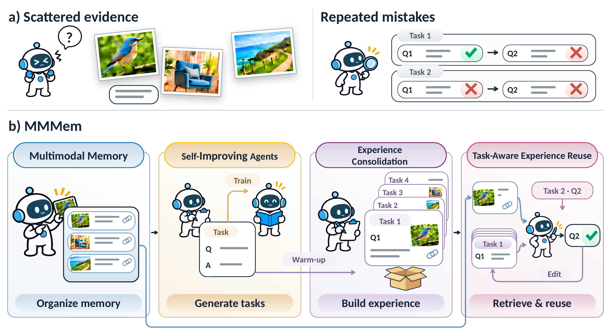
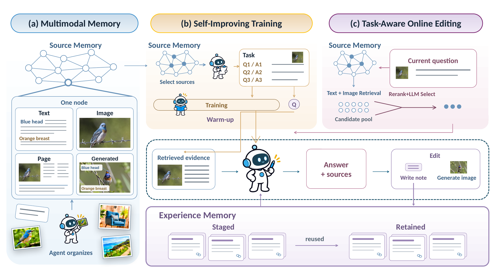
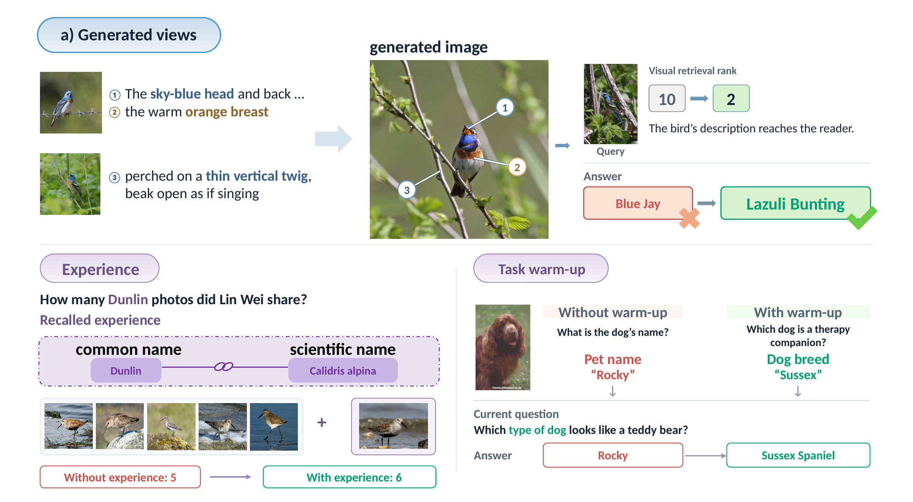

<div align="center">

# MMMem

### Self-Improving Agents with Task-Aware<br>Multimodal Experience Consolidation

**Anonymous Authors**

<!-- The current manuscript lists Anonymous Authors. Replace this line with the
     author-approved names, affiliations, and contribution markers. -->

[Overview](#overview) · [Framework](#framework) · [Case studies](#case-studies) · [Quick start](#quick-start) · [Usage](USAGE.md)

</div>

## Overview

**MMMem connects scattered multimodal evidence and reuses experience across tasks.** It organizes text, images, pages, and generated views into source-linked memory, learns from self-generated tasks, and consolidates task experience for later retrieval and editing.



*Figure 1. Multimodal memory brings evidence together; self-improvement and experience consolidation help the agent reuse what it learns in later tasks.*

## Framework



*Figure 2. Source memory feeds self-generated tasks and downstream retrieval. Training updates the reader; warm-up and online editing build experience memory.*

- **Multimodal Memory.** Organize source records into linked nodes with text, original images, rendered pages, and generated scene views. Each view links back to its source evidence.
- **Self-Improving Training.** Generate tasks from source memory. Tasks from separate training sources fine-tune the reader with LoRA; source-generated warm-up tasks initialize experience memory with reader weights fixed.
- **Task-Aware Online Editing.** Retrieve source evidence and relevant experience, answer with source references, and write a new experience. Staged experiences advance to long-term retention through supported reuse.

The implementation supports **Qwen3.5-9B** and **MiniCPM-V 4.5** readers. See the [experiment guide](USAGE.md) for data preparation, task generation, LoRA training, warm-up, evaluation, and component controls.

## Case studies



*Figure 3. Examples from the paper trace generated views, recalled experience, and task warm-up through the evidence and answers.*

## Quick start

Run commands from the repository root. Python 3.10–3.12 is supported.

```bash
python -m venv .venv
source .venv/bin/activate
python -m pip install -r requirements.txt
export MMMEM_WORKSPACE="$HOME/mmmem-workspace"
mkdir -p "$MMMEM_WORKSPACE"

python scripts/run_memorium_u05_cell.py \
  --cell examples --split examples/split.json \
  --arm F_v2_zero --routes T \
  --experience on --exp-topk 1 --exp-outside \
  --output "$MMMEM_WORKSPACE/runs/cpu-demo" --dry-run
```

The CPU example uses a hash encoder and an echo reader to show the input and output formats. Each run takes a fresh output directory.

## GPU quick start

<details>
<summary>Run the example with a LoRA reader, image generation, retrieval, and warm-up</summary>

Use a CUDA GPU with 80 GB of memory for this example. Install the model dependencies and place these downloaded model snapshots under `$MMMEM_WORKSPACE/models/`.

- `Qwen3.5-9B`
- `Qwen3-Embedding-0.6B`
- `Qwen3-VL-Embedding-2B`, including its upstream `scripts/qwen3_vl_embedding.py`
- `Qwen3-Reranker-0.6B`
- `Qwen-Image`

Place the reader's LoRA adapter at `$MMMEM_WORKSPACE/adapters/qwen/` and set `VMC_CANVAS_FONT` to a TrueType font available through Fontconfig.

```bash
python -m pip install -r requirements-models.txt

python scripts/run_memorium_u05_cell.py \
  --cell examples --split examples/split.json \
  --reader-model "$MMMEM_WORKSPACE/models/Qwen3.5-9B" \
  --reader-backend qwen35 \
  --text-encoder "$MMMEM_WORKSPACE/models/Qwen3-Embedding-0.6B" \
  --visual-encoder "$MMMEM_WORKSPACE/models/Qwen3-VL-Embedding-2B" \
  --image-model "$MMMEM_WORKSPACE/models/Qwen-Image" \
  --reranker "$MMMEM_WORKSPACE/models/Qwen3-Reranker-0.6B" \
  --reader-adapter "$MMMEM_WORKSPACE/adapters/qwen" \
  --arm F_v2 --routes TV --v1-level session --v2-unit-budget 1 \
  --read-generated-views --token-budget 1500 \
  --experience on --exp-image off --exp-topk 1 --exp-outside \
  --exp-promote-uses 2 --exp-promote-families 1 \
  --warmup-tasks examples/warmup.jsonl \
  --output "$MMMEM_WORKSPACE/runs/gpu-demo"
```

This runs one warm-up task and two downstream tasks with real encoders, image generation, reranking, and a LoRA reader. Results include `rows.jsonl`, `warmup_rows.jsonl`, and `run_manifest.json`. For the base reader, use `F_v2_zero` and omit `--reader-adapter`.

</details>

## Benchmarks

| Benchmark | Memory unit | Source evidence |
| --- | --- | --- |
| LoCoMo | Conversation | Dialogue and released image captions |
| Mem-Gallery | Scenario | Dialogue, photos, and query images |
| LooGLE v2 | Document | Long documents |

[Usage](USAGE.md) covers the unit splits, data preparation, training, warm-up, evaluation, and component controls for Qwen3.5-9B and MiniCPM-V 4.5. Download benchmark data and base models from their original providers. Store data, adapters, caches, and run outputs in `$MMMEM_WORKSPACE`.

## Code

| Path | Contents |
| --- | --- |
| `memorium/` | Memory construction, retrieval, editing, and experience consolidation |
| `memorium/training/` | Synthetic tasks and training examples |
| `scripts/` | Preparation, training, inference, and scoring |
| `configs/` | Source-unit splits |
| `examples/` | Small synthetic example |

Run the CPU tests with `python -m unittest discover -s tests`.
