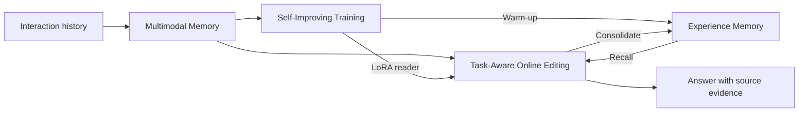

# MMMem

**Self-Improving Agents with Task-Aware Multimodal Experience Consolidation**

MMMem links scattered text and image evidence, trains an agent on self-generated tasks, and consolidates task experience for later retrieval and reuse.



[Usage](USAGE.md) · [Data and models](USAGE.md#data-and-models) · [GPU quick start](#gpu-quick-start)

## Multimodal Memory

Organize source records into linked nodes. A node can carry text, original images, rendered pages, and generated scene views, with references back to the original evidence.

## Self-Improving Training

Generate tasks from source memory. Use training-unit tasks for offline LoRA and source-generated warm-up tasks to initialize the experience memory of an evaluation unit. Reader weights stay fixed during downstream tasks.

## Task-Aware Online Editing

Retrieve source evidence and relevant experience, answer with source references, and write a task summary. Staged experiences can be consolidated into long-term memory through supported reuse.

## Quick start

Run commands from the repository root. Python 3.10–3.12 is supported.

```bash
python -m venv .venv
source .venv/bin/activate
python -m pip install -r requirements.txt
export MMMEM_WORKSPACE="$HOME/mmmem-workspace"
mkdir -p "$MMMEM_WORKSPACE"

python scripts/run_memorium_u05_cell.py \
  --cell examples --split examples/split.json \
  --arm F_v2_zero --routes T \
  --experience on --exp-topk 1 --exp-outside \
  --output "$MMMEM_WORKSPACE/runs/cpu-demo" --dry-run
```

The CPU example uses a hash encoder and an echo reader to show the input and output formats. Each run takes a fresh output directory.

## GPU quick start

Use a CUDA GPU with 80 GB of memory for this example. Install the model dependencies and place these downloaded model snapshots under `$MMMEM_WORKSPACE/models/`.

- `Qwen3.5-9B`
- `Qwen3-Embedding-0.6B`
- `Qwen3-VL-Embedding-2B`, including its upstream `scripts/qwen3_vl_embedding.py`
- `Qwen3-Reranker-0.6B`
- `Qwen-Image`

Place the reader's LoRA adapter at `$MMMEM_WORKSPACE/adapters/qwen/` and set `VMC_CANVAS_FONT` to a TrueType font available through Fontconfig.

```bash
python -m pip install -r requirements-models.txt

python scripts/run_memorium_u05_cell.py \
  --cell examples --split examples/split.json \
  --reader-model "$MMMEM_WORKSPACE/models/Qwen3.5-9B" \
  --reader-backend qwen35 \
  --text-encoder "$MMMEM_WORKSPACE/models/Qwen3-Embedding-0.6B" \
  --visual-encoder "$MMMEM_WORKSPACE/models/Qwen3-VL-Embedding-2B" \
  --image-model "$MMMEM_WORKSPACE/models/Qwen-Image" \
  --reranker "$MMMEM_WORKSPACE/models/Qwen3-Reranker-0.6B" \
  --reader-adapter "$MMMEM_WORKSPACE/adapters/qwen" \
  --arm F_v2 --routes TV --v1-level session --v2-unit-budget 1 \
  --read-generated-views --token-budget 1500 \
  --experience on --exp-image off --exp-topk 1 --exp-outside \
  --exp-promote-uses 2 --exp-promote-families 1 \
  --warmup-tasks examples/warmup.jsonl \
  --output "$MMMEM_WORKSPACE/runs/gpu-demo"
```

This runs one warm-up task and two downstream tasks with real encoders, image generation, reranking, and a LoRA reader. Results include `rows.jsonl`, `warmup_rows.jsonl`, and `run_manifest.json`. For the base reader, use `F_v2_zero` and omit `--reader-adapter`.

## Benchmarks

| Benchmark | Memory unit | Source evidence |
| --- | --- | --- |
| LoCoMo | Conversation | Dialogue and released image captions |
| Mem-Gallery | Scenario | Dialogue, photos, and query images |
| LooGLE v2 | Document | Long documents |

[Usage](USAGE.md) covers the unit splits, data preparation, training, warm-up, evaluation, and component controls for Qwen3.5-9B and MiniCPM-V 4.5. Download benchmark data and base models from their original providers. Store data, adapters, caches, and run outputs in `$MMMEM_WORKSPACE`.

## Code

| Path | Contents |
| --- | --- |
| `memorium/` | Memory construction, retrieval, editing, and experience consolidation |
| `memorium/training/` | Synthetic tasks and training examples |
| `scripts/` | Preparation, training, inference, and scoring |
| `configs/` | Source-unit splits |
| `examples/` | Small synthetic example |

Run the CPU tests with `python -m unittest discover -s tests`.
